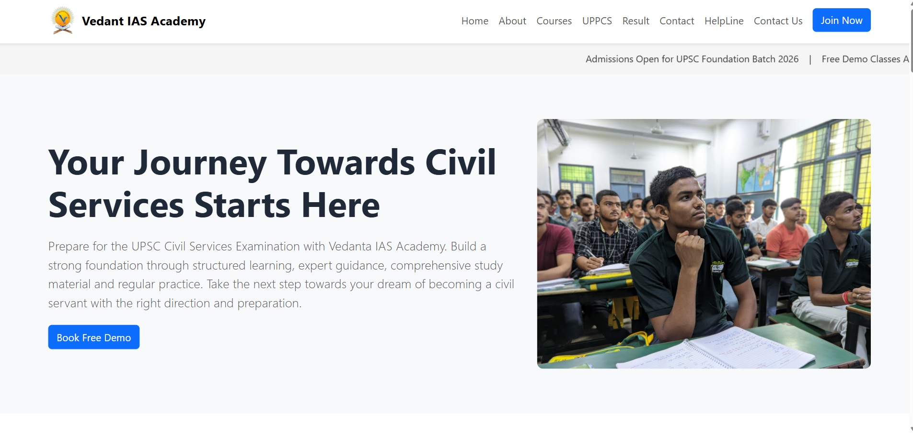
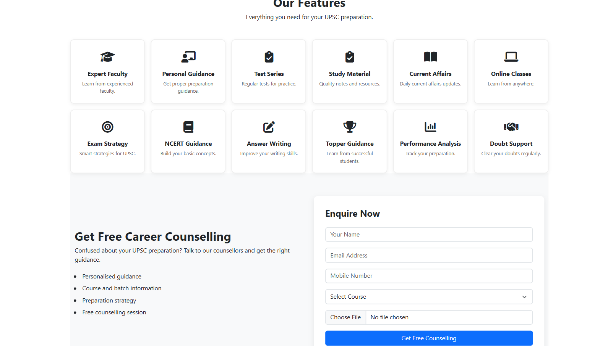
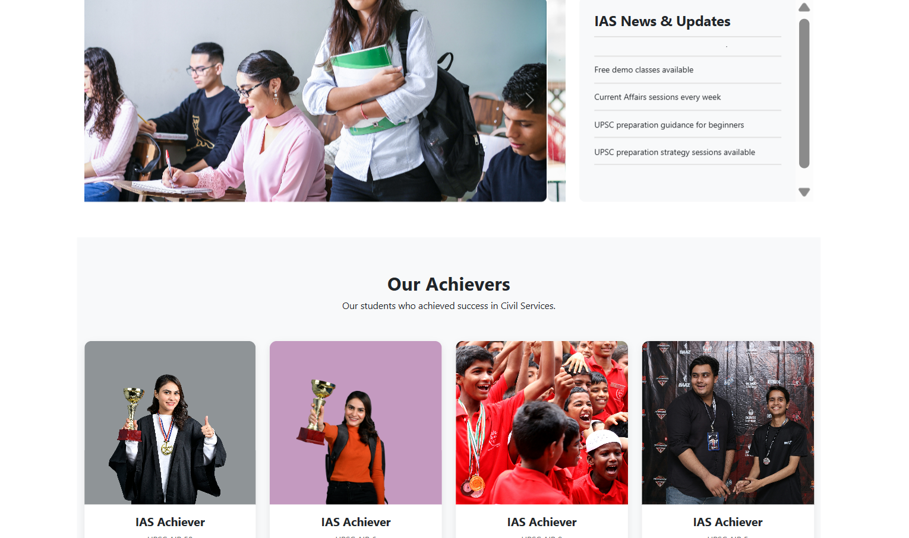
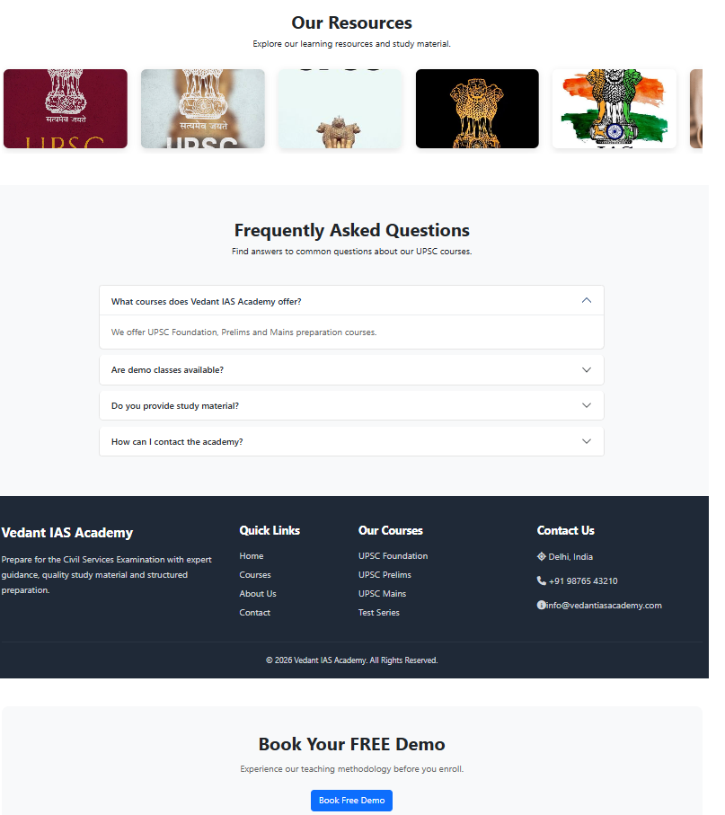
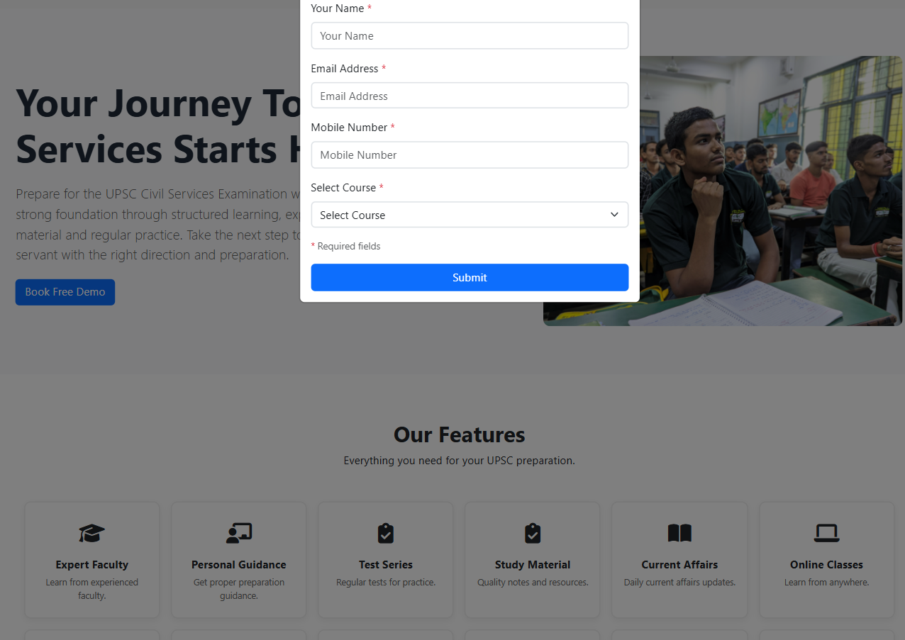
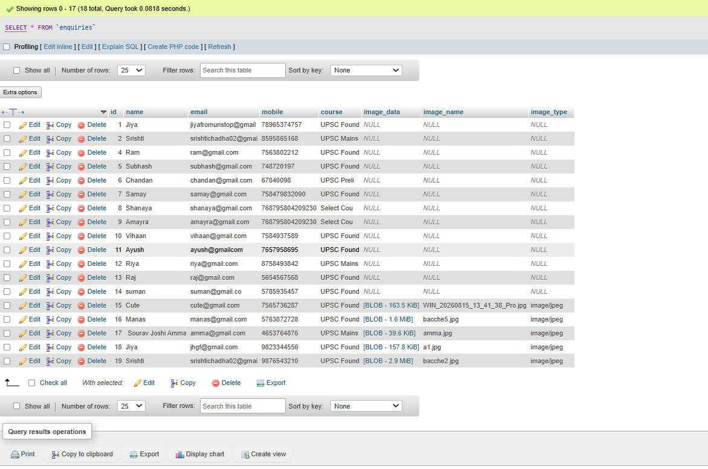
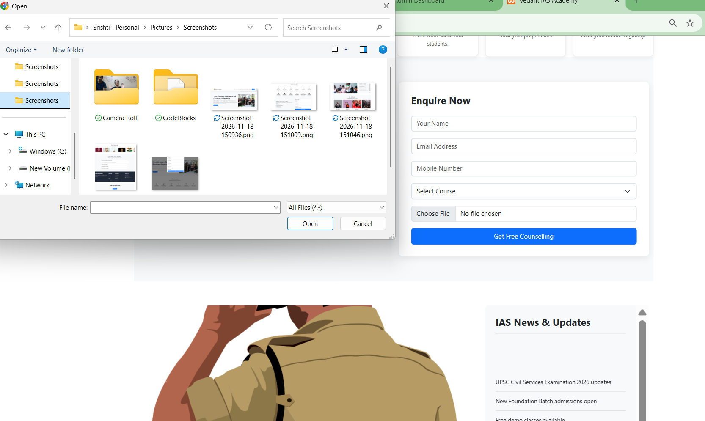
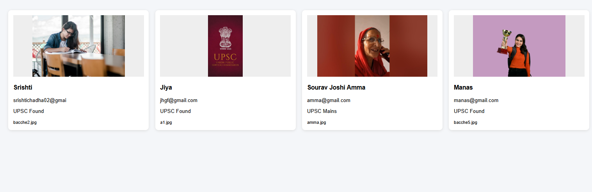
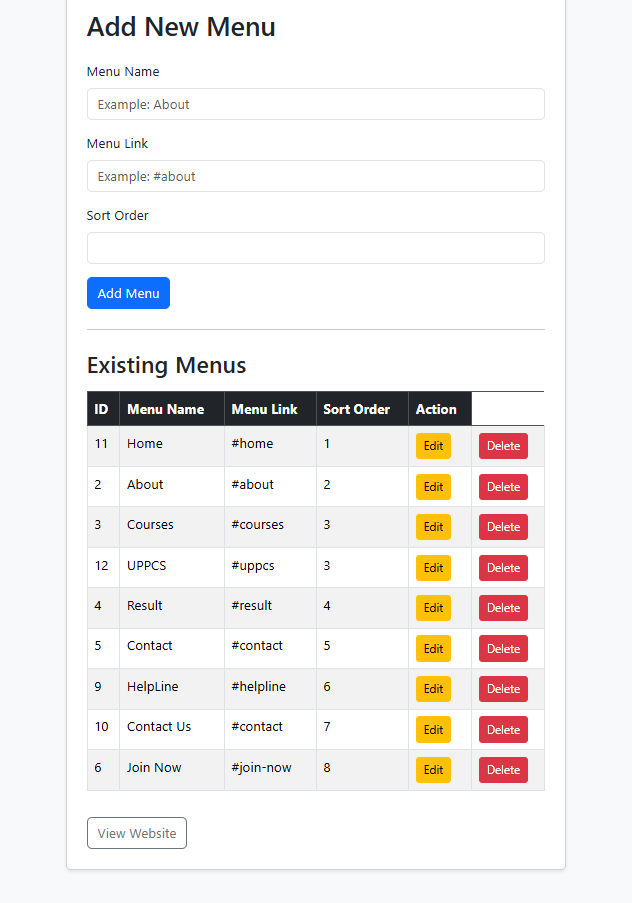
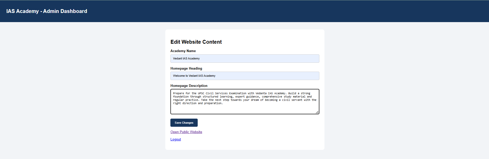

# IAS Academy – PHP Practice Project

## About the Project

This project is a basic IAS Academy website developed using PHP, MySQL, HTML, CSS and JavaScript.

The main purpose of this project was to practise PHP and MySQL by adding different website features, creating forms, managing menu items and connecting website functionality with a database.

It is an early-stage project with some implemented features and pages. It is not a complete or fully functional coaching website.

## Features Implemented

- Created basic website pages and sections.
- Added scrolling text and images using marquee tags.
- Created a navigation menu with options to add menu name, link and display order.
- Implemented basic CRUD operations for menu management.
- Used Flaticon icons in website sections.
- Added an automatic image carousel.
- Created a scrollable IAS News and Updates section.
- Added an Enquire Now form with name, phone number and email validations.
- Added a file upload option to the enquiry form.
- Created a gallery page to display uploaded images.
- Added Book Free Demo and Get Counselling enquiry options.
- Connected enquiry and demo form submissions with MySQL database.
- Created a basic admin login and dashboard.
- Added options in the admin dashboard to update academy name, homepage heading and description.

## Technologies Used

- HTML
- CSS
- JavaScript
- PHP
- MySQL
- XAMPP


## Project Structure

```text
ias_academy/
│
├── admin/
├── images/
├── Screenshots/
├── index.php
├── db.php
├── admin_menu.php
├── edit_menu.php
├── delete_menu.php
├── save_menu.php
├── update_menu.php
├── gallery.php
├── submit_enquiry.php
├── view_image.php
├── style.css
└── README.md
```

## Screenshots

### Homepage









### Forms and Database





### Image Upload and Gallery





### Menu Management and Admin Dashboard





## Database

The project uses MySQL with the database name `ias_academy`.

Some implemented form submissions and uploaded image information are stored in the database.

## How to Run Locally

1. Install XAMPP.
2. Start Apache and MySQL.
3. Place the project folder inside `htdocs`.
4. Create a database named `ias_academy`.
5. Import the required database tables.
6. Configure the database connection in `db.php`.
7. Open the project in your browser:

```text
http://localhost:84/ias_academy/
```

## Project Scope

This is a beginner-level practice project. Different PHP and MySQL features have been added and tested, but not all website pages, navigation links or sections are fully functional.

The project was developed to gain practical experience with PHP forms, database operations, file uploads, CRUD functionality and basic admin panel development.

## Developed By

**Srishti Chadha**

GitHub: [12srishti34](https://github.com/12srishti34)